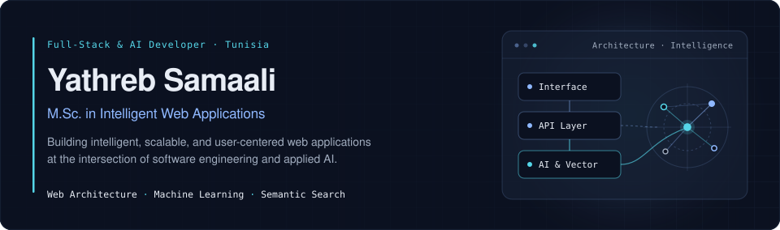

  

  <a href="https://yathrebsamaali.vercel.app/">Portfolio</a> &nbsp;&middot;&nbsp;
  <a href="https://www.linkedin.com/in/yathreb-samaali">LinkedIn</a> &nbsp;&middot;&nbsp;
  <a href="https://github.com/YathrebSamaali?tab=repositories">Repositories</a> &nbsp;&middot;&nbsp;
  <a href="mailto:yathrebsamaali25@gmail.com">yathrebsamaali25@gmail.com</a>

 

## About Me

I am a **Full-Stack & AI Developer** based in Tunisia, holding a **Professional Master's degree in Intelligent Web Applications** and a **Bachelor's degree in Software and Systems Engineering** from the Higher Institute of Computer Science of Kef (ISI Kef).

My work focuses on building dependable, well-structured web applications—combining frontend interfaces and backend APIs in **React**, **Angular**, **TypeScript**, **Spring Boot**, and **FastAPI** with applied AI capabilities including **Machine Learning**, **NLP**, **Retrieval-Augmented Generation (RAG)**, **semantic search**, and **recommendation systems**. I care about clean architecture, readable code, and building software that solves concrete problems.

 

## Technical Expertise

  

| Category | Verified Technologies |
| :--- | :--- |
| **Frontend** | `React` · `Angular` · `TypeScript` · `JavaScript` · `HTML5` · `CSS3` · `Bootstrap` |
| **Backend** | `Spring Boot` · `FastAPI` · `Django` · `Node.js` · `Express` · `Laravel` · `Flask` |
| **Languages** | `Python` · `Java` · `TypeScript` · `JavaScript` · `PHP` · `C#` · `C++` |
| **AI & Machine Learning** | `PyTorch` · `TensorFlow` · `Scikit-Learn` · `LangChain` · `FAISS` · `Sentence Transformers` · `YOLOv5` · `Mask R-CNN` · `OpenCV` |
| **Databases & Search** | `PostgreSQL` · `MySQL` · `MongoDB` · `Redis Stack` · `Oracle` · `SQLite` |
| **Tools & Infrastructure** | `Docker` · `Kubernetes` · `Jenkins` · `Terraform` · `SonarQube` · `Prometheus` · `Grafana` · `AWS` · `Git` · `Linux` |

 

## Featured Projects

### Flagship · Mawjoude — Intelligent Multi-Vendor Marketplace

> **Master's Graduation Project (Zeus Labs)** · *Private thesis repository — [Documented on Portfolio](https://yathrebsamaali.vercel.app/)*
>
> Designed and built an intelligent multi-vendor e-commerce platform combining a **hybrid recommendation engine** (content-based and collaborative filtering) with **semantic vector search** powered by Sentence Transformers and Redis Stack to personalize product discovery and improve search relevance across React.js, Spring Boot (Java 21), and Python FastAPI services.
>
> `React.js` · `Spring Boot (Java 21)` · `Python` · `FastAPI` · `PostgreSQL` · `Redis Stack` · `Sentence Transformers`

 

### Selected Public Repositories

<table width="100%">
  <tr>
    <td width="50%" valign="top">
      <strong><a href="https://github.com/YathrebSamaali/multi-document-chatbot">Multi-Document Chatbot</a></strong> 
      Conversational RAG Assistant
      
AI assistant built with Streamlit to query PDF, DOCX, and PPTX documents using LangChain conversation pipelines and FAISS vector similarity search.

      <code>Python</code> &middot; <code>LangChain</code> &middot; <code>FAISS</code> &middot; <code>Streamlit</code>
    </td>
    <td width="50%" valign="top">
      <strong><a href="https://github.com/YathrebSamaali/fish_detection">Fish Species Detection</a></strong> 
      Aquaculture Computer Vision Pipeline
      
Automated detection, identification, and instance segmentation of fish species in aquaculture environments combining YOLOv5 and Mask R-CNN.

      <code>Python</code> &middot; <code>PyTorch</code> &middot; <code>YOLOv5</code> &middot; <code>Mask R-CNN</code> &middot; <code>OpenCV</code>
    </td>
  </tr>
  <tr>
    <td width="50%" valign="top">
      <strong><a href="https://github.com/YathrebSamaali/PRM-25">PRM-25</a></strong> 
      Full-Stack Property Management Platform
      
Full-stack property management application featuring JWT authentication, role-based access control, structured REST APIs, and MySQL persistence.

      <code>Angular</code> &middot; <code>TypeScript</code> &middot; <code>Spring Boot</code> &middot; <code>Java 17</code> &middot; <code>MySQL</code>
    </td>
    <td width="50%" valign="top">
      <strong><a href="https://github.com/YathrebSamaali/devops-project">StationSKI — DevOps Pipeline</a></strong> 
      Automated CI/CD &amp; Observability Stack
      
Modular Spring Boot and Angular application supported by automated CI/CD, quality gates, containerization, IaC provisioning, and monitoring.

      <code>Docker</code> &middot; <code>Kubernetes</code> &middot; <code>Jenkins</code> &middot; <code>Terraform</code> &middot; <code>Grafana</code>
    </td>
  </tr>
  <tr>
    <td colspan="2" valign="top">
      <strong><a href="https://github.com/YathrebSamaali/SuiviEcrans">SuiviEcrans</a></strong> &mdash; Industrial Traceability Web Application (CIPI ACTIA) 
      Built during an internship at CIPI ACTIA to automate screen-printing screen tracking across production and cleaning workflows with searchable history and export. 
      <code>PHP</code> &middot; <code>JavaScript</code> &middot; <code>PostgreSQL</code> &middot; <code>Bootstrap</code>
    </td>
  </tr>
</table>

Explore all public repositories and commit history on [GitHub Repositories](https://github.com/YathrebSamaali?tab=repositories).

 

## Engineering Focus

<table width="100%">
  <tr>
    <td width="50%" valign="top">
      <strong>01 · Full-Stack Architecture</strong> 
      Designing modular REST APIs and multi-service backends with Spring Boot and FastAPI, paired with predictable, component-driven frontends in React, Angular, and TypeScript.
    </td>
    <td width="50%" valign="top">
      <strong>02 · Applied AI &amp; RAG Systems</strong> 
      Integrating LLM orchestration, document chunking, and dense vector retrieval into practical software workflows with LangChain and FAISS.
    </td>
  </tr>
  <tr>
    <td width="50%" valign="top">
      <strong>03 · Semantic Search &amp; Recommendations</strong> 
      Improving product and information discovery through embedding models, Redis vector indexing, and hybrid recommendation strategies.
    </td>
    <td width="50%" valign="top">
      <strong>04 · Reliable Delivery &amp; Tooling</strong> 
      Supporting maintainable software lifecycles with containerization, relational data modeling, automated testing pipelines, and clear documentation.
    </td>
  </tr>
</table>

 

## Connect

Open to **Full-Stack Developer** and **AI / Intelligent Web Systems** opportunities, technical collaborations, and engineering discussions.

| Channel | Link |
| :--- | :--- |
| **Email** | [yathrebsamaali25@gmail.com](mailto:yathrebsamaali25@gmail.com) |
| **LinkedIn** | [linkedin.com/in/yathreb-samaali](https://www.linkedin.com/in/yathreb-samaali) |
| **Portfolio** | [yathrebsamaali.vercel.app](https://yathrebsamaali.vercel.app/) |
| **GitHub** | [github.com/YathrebSamaali](https://github.com/YathrebSamaali) |
