

  

  <a href="#about-me">About</a> &nbsp;&middot;&nbsp;
  <a href="#skills">Skills</a> &nbsp;&middot;&nbsp;
  <a href="#featured-projects">Projects</a> &nbsp;&middot;&nbsp;
  <a href="#connect">Connect</a>

 

  

## About Me

I am a **Full-Stack & AI Developer** based in Tunisia, holding a **Professional Master's Degree in Intelligent Web Applications** from the Higher Institute of Computer Science of Kef (ISI Kef).

My work sits at the intersection of modern web engineering and applied Artificial Intelligence. I build end-to-end applications—from responsive interfaces and modular REST APIs to intelligent features powered by Machine Learning, NLP, semantic search, and recommendation systems—with a focus on clean architecture, maintainability, and solving real problems.

- **Education:** Professional Master's Degree in Intelligent Web Applications (ISI Kef)
- **Core Focus:** Full-Stack Web Architecture · Applied AI, RAG & Semantic Search · Recommendation Systems

 

  

## Skills

#### Languages

  
  
  
  
  

#### Frontend

  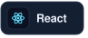
  
  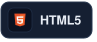
  
  

#### Backend

  
  
  
  
  
  

#### AI &amp; Machine Learning

  
  
  
  
  
  
  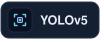

#### Databases

  
  
  
  

#### Tools &amp; DevOps

  
  
  
  
  
  
  
  

 

  

## Featured Projects

#### Flagship Project

  <a href="https://yathrebsamaali.vercel.app/">
    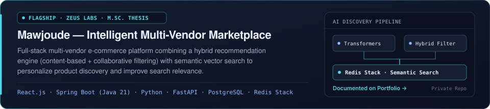
  </a>

#### Selected Public Repositories

  <a href="https://github.com/YathrebSamaali/multi-document-chatbot">
    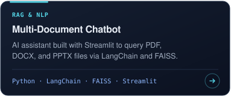
  </a>
  <a href="https://github.com/YathrebSamaali/fish_detection">
    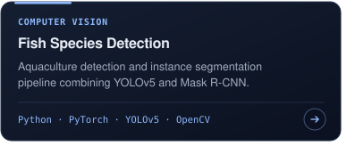
  </a>
   
  <a href="https://github.com/YathrebSamaali/PRM-25">
    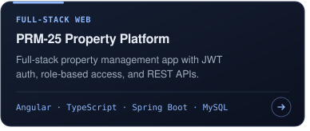
  </a>
  <a href="https://github.com/YathrebSamaali/devops-project">
    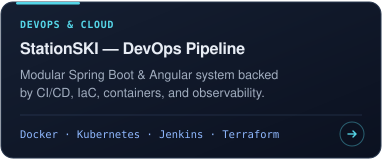
  </a>
   
  <a href="https://github.com/YathrebSamaali/SuiviEcrans">
    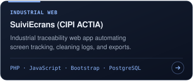
  </a>

  <a href="https://github.com/YathrebSamaali?tab=repositories">Browse all public repositories &rarr;</a>

 

  

## Connect

Open to **Full-Stack Developer** and **AI / Intelligent Web Systems** opportunities, technical collaborations, and engineering conversations.

  
  <a href="https://github.com/YathrebSamaali">
    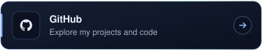
  </a>
   
  
  <a href="https://yathrebsamaali.vercel.app">
    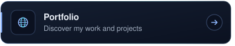
  </a>

  Direct email: <a href="mailto:yathrebsamaali25@gmail.com"><code>yathrebsamaali25@gmail.com</code></a>

